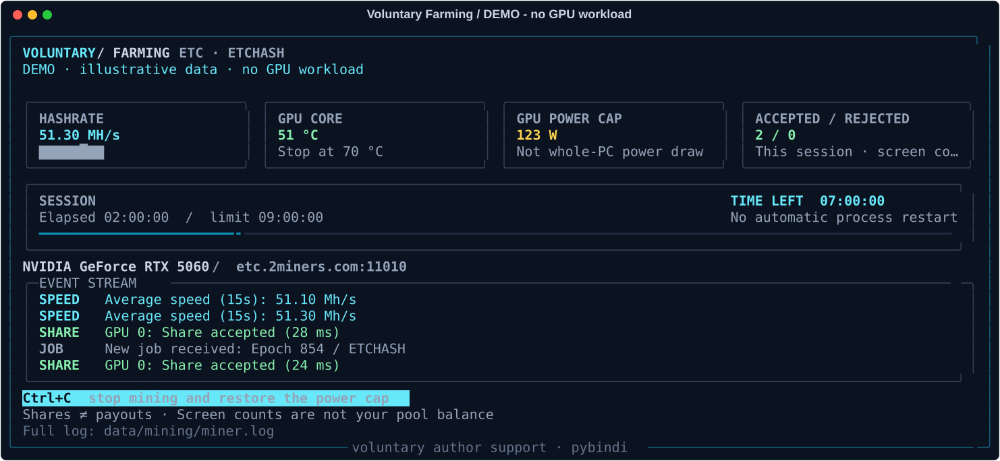

<div align="center">

# Voluntary Farming

### Your hardware. Your choice. Transparent author support.

A Windows GPU-mining controller with a polished Rich dashboard,<br>
explicit opt-in, bounded sessions, and power-recovery checks.


[Quick start](#quick-start) · [Dashboard](#dashboard) · [Safety](#safety--recovery) · [Author support](#author-support) · [Changelog](CHANGELOG.md)

</div>

> [!IMPORTANT]
> **This is voluntary farming to support the author, not an income service for the operator.**
> The default reward recipient is the author. The operator pays for electricity,
> fees, hardware load, and wear. Mining can cost substantially more than the ETC
> it produces. No revenue, profitability, payout schedule, or hardware safety is guaranteed.

Mining is **disabled by default**. No hidden mining, Windows autostart, automatic
miner download, or automatic process restart. Use only hardware you own or have
explicit permission to use, with informed consent about the recipient and costs.
Do not distribute versions that hide these terms or mine without consent.

## Dashboard



*Illustrative demo, not live telemetry or proof of earnings.*

| At a glance | Details |
|---|---|
| **Performance** | Reported hashrate with a compact recent-history sparkline |
| **GPU health** | Core temperature, stop threshold, and configured power cap |
| **Session control** | Elapsed time, time remaining, and progress bar |
| **Event stream** | Color-coded `SHARE`, `SPEED`, `JOB`, and warning entries |
| **Adaptive layout** | Four cards on wide terminals, two columns on standard windows, compact mode on smaller screens |
| **Full logs** | Raw miner output retained locally, independently of rendering |

The power card shows the **GPU power limit**, not whole-PC consumption. Share
counts reflect this session's displayed messages, not the pool balance; screen
events may be dropped under backpressure. The sparkline shows reported samples,
not a forecast. Revenue and wallet balance are not calculated.

Safe UI preview — **no mining, network access, UAC, or GPU changes**:

```powershell
python -m pip install -r requirements-mining.txt
python -X utf8 .\mining_console.py
```

Rich is optional. Missing Rich or redirected output falls back to plain text.
Windows Terminal is recommended; BAT launchers enable Python UTF-8 mode.

## Before you begin

| Requirement | Supported profile |
|---|---|
| OS / runtime | Windows, Python 3.11+, stock NVIDIA driver and `nvidia-smi` |
| Hardware | Exactly one NVIDIA GPU; developed and exercised on an RTX 5060 |
| Workload | lolMiner 1.98a · ETCHASH · Ethereum Classic (ETC) |
| Power ceiling | 123 W; the requested limit must be supported by your GPU |
| Thermal stop | At or below 70 °C core temperature |
| Session ceiling | 9 hours, with a 10-second shutdown reserve |
| Polling | Up to 2 seconds between checks, plus sensor-query latency |

This is **not a universal GPU optimizer**. Other hardware has not been validated.
Do not assume these settings fit another card or raise the code's hard ceilings
without reviewing the implementation. GPU utilization may still reach 100%:
power limiting is not a utilization percentage cap. CPU mining is not started;
the miner and driver still use some CPU. The controller does not overclock,
change voltage/clocks, or control fans.

## Author support

**Author:** [pybindi](https://github.com/pybindi)

**Network:** Ethereum Classic (**ETC**, not ETH or TON)

```text
0x3D4048E18480E900eD98EaD66e543786860723D7
```

The recipient is visible in `mining_config.json` and can be inspected or changed
before launching. There is no hidden wallet substitution. **Never provide a seed
phrase or private key** — neither is needed. The pool sees the address, worker,
and connection details; address statistics may be public.

An accepted share is **not a wallet payout**. The pool accounts for rewards and
pays according to its own threshold and schedule. Independently verify fees,
minimum payouts, current service availability, regional terms, and tax obligations.

- Default endpoint: `etc.2miners.com:11010`, TLS enabled.
- Pool setup and terms: [2Miners ETC help](https://etc.2miners.com/help).
- lolMiner documents a 0.7% ETCHASH developer fee; terms can change.

## Quick start

### 1 · Install the interface dependency

```powershell
python -m pip install -r requirements-mining.txt
```

### 2 · Obtain and verify the miner

Download the official [lolMiner 1.98a Win64 release](https://github.com/Lolliedieb/lolMiner-releases/releases/tag/1.98a),
review its license, and extract the required EXE/runtime files into
`miners/lolMiner-1.98a/`. **The miner and its DLLs are not bundled here.**

<details>
<summary><strong>Pinned release hashes and verification</strong></summary>

| Artifact | SHA256 |
|---|---|
| `lolMiner_v1.98a_Win64.zip` | `f2bbda2d2255155d50935967b8c55105b9aeefbd27cda3e8d01beaf535a16762` |
| `lolMiner.exe` | `45d54e54e0bfcae4f983a8c5db88d1e3fed1618b26d4461c76af8027c4ec4616` |

```powershell
Get-FileHash .\miners\lolMiner-1.98a\lolMiner.exe -Algorithm SHA256
```

A matching hash pins a particular file; it does **not** guarantee safety. The
EXE's Authenticode trust chain was not confirmed during development. Do not
replace the expected hash with an arbitrary one just to bypass a mismatch.

</details>

> [!WARNING]
> Do not disable antivirus, Smart App Control, or other protections, or add broad
> exclusions to make a miner run. Investigate any block first. Your security
> policy may legitimately prevent this software from starting.

### 3 · Configure your GPU once

```powershell
nvidia-smi --query-gpu=uuid,name,power.min_limit,power.max_limit --format=csv
```

In `mining_config.json`, replace the all-zero GPU UUID placeholder with your
device UUID. Review `wallet`, `pool`, `worker`, the EXE path/hash, power limit,
and `max_hours`. Do not expect configuration edits to change a running session.
The distributed configuration stays `enabled=false` until you explicitly opt in.

### 4 · Choose a session

Open PowerShell in the project directory **without administrator rights**.

| Action | Command | What it does |
|---|---|---|
| UI demo | `python -X utf8 .\mining_console.py` | Sample data only; no workload |
| Setup check | `.\MINING.bat check` | No mining; reports disabled status until opted in |
| Short trial | `.\MINING.bat trial` | Real mining for up to 10 minutes |
| Normal session | `.\START_MINING.bat` | Runs `MINING.bat run`; requires `enabled=true` |
| Stop | **Ctrl+C in the controller window** | Stops owned processes, then restores the original power limit |
| Recover | `.\MINING.bat restore` | Completes pending power recovery; may require elevation |

> [!CAUTION]
> **`trial` is real mining**, not a UI preview. It uses electricity and sends
> rewards to the configured recipient, even when `enabled=false`. Approve the
> separate power-helper UAC prompt only after reviewing the script and settings.

For normal sessions, set `"enabled": true` once and choose a duration from
1 minute to 9 hours. Then double-click **`START_MINING.bat`** whenever you want
to start; no per-session config edit is needed. `.\MINING.bat run` is equivalent.
UAC, sensor checks, supported power limits, duplicate-instance prevention, and
pending-recovery blocks still apply. This does not enable Windows autostart.

Double-clicking `MINING.bat` itself runs **only the check**, not mining.
Keep the separate power-helper window open until recovery finishes.

## Safety & recovery

```text
Explicit launch → validate settings → save original power cap → UAC helper
                → apply and verify cap → start contained workload
                → monitor time / core temperature / cap / process
                → stop owned processes → restore and verify original cap
```

- **Least privilege.** The miner stays unelevated. The separate
  `mining_power.ps1` helper launches only stock `nvidia-smi` for power control.
- **Process-scoped permission.** The helper uses `-ExecutionPolicy RemoteSigned`.
  Persistent PowerShell policy is unchanged; organization policy takes priority.
  This is not a Defender exclusion or security-policy bypass.
- **Recovery journal.** Original power is saved in `data/mining/power-restore.json`
  before changes. The workload starts only after verifying the requested cap.
- **Contained processes.** A Windows Job Object owns the helper/workload tree.
  Normal shutdown confirms the whole group has stopped before raising the cap.
  Unrelated processes are not killed by name. The original limit is restored;
  it is **not necessarily 145 W**.
- **Fail closed.** Sensor failures, changed power caps, miner exit, or log-write
  failures stop the session. An unfinished recovery blocks a new start.
  Do not delete the journal to bypass it. Use `MINING.bat restore` only with
  mining stopped; a write may need a separate elevated window. Never mine in that window.
- **Best-effort crash recovery.** When the controller exits, Windows closes its
  job and the independent power helper attempts recovery. Power loss, a hung
  OS/driver, or terminating the helper can prevent restoration. Exact timing and
  recovery are **not guaranteed** under those conditions.
- **Temperature limitations.** Only core temperature is monitored, not every
  hotspot/VRAM sensor. Temperature can rise between polls. Observe your first run.
  Do not put the PC to sleep/hibernate during a session.
- **Independent rendering.** Terminal I/O does not run in the safety loop.
  A slow terminal may drop screen-only events, not the raw log. Screen failure
  does not disable workload shutdown. These are software safeguards, not a
  guarantee against hardware damage.

## Connection troubleshooting

lolMiner can reconnect to the pool within the same running process. This is
different from restarting an exited miner, which the controller never does.
Repeated `Lost connection to stratum server` messages waste work; a successful
TLS handshake and new jobs show reconnection, not the cause of the outage.

Prefer stable Ethernet if Wi-Fi is unreliable. Check whether other applications
also lose connectivity before blaming the pool. A VPN may improve or worsen a
route; do not use it to evade service restrictions. No network, DNS, firewall,
or VPN settings are changed by this project.

## Costs & privacy

At a sustained 123 W, the GPU alone uses about **1.107 kWh in 9 hours**. The rest
of the PC adds consumption. Subtract electricity, pool/miner fees, exchange costs,
and wear from mining proceeds. There is **no profitability calculator or automatic
loss-based shutdown**. Participation is optional; you can stop at any time.

Logs stay local in `data/mining/guard.log` and `data/mining/miner.log`. Review logs
before sharing them. Miner binaries, device-specific configuration from the
development PC, credentials, and operating logs are not included in the repository.

## Development

```powershell
python -X utf8 -m unittest -v test_mine_guard.py test_mining_console.py
```

Tests use fake GPU models and ordinary Python child processes. They do not mine,
download miners, change GPU settings, or contact a pool. Coverage includes time
and thermal stops, restoration ordering, process containment, output streaming,
Unicode handling, blocked terminals, responsive layouts, and fallback rendering.
Passing tests do not establish payouts, profitability, third-party EXE safety,
or driver reliability on arbitrary hardware.

### Project map

| File | Purpose |
|---|---|
| `START_MINING.bat` | Explicit double-click launcher for an opted-in normal session |
| `MINING.bat` | Check / trial / run / restore entry point |
| `mine_guard.py` | Validation, process containment, supervision, recovery |
| `mining_power.ps1` | Elevated, power-only helper |
| `mining_console.py` | Adaptive Rich dashboard and harmless demo |
| `mining_config.json` | Visible recipient and disabled-by-default hardware template |
| `docs/dashboard.svg` | Generated illustrative dashboard preview |

---

<div align="center">
<strong>Voluntary by design. Visible by default.</strong><br>
Built by <a href="https://github.com/pybindi">pybindi</a> · No promised returns.
</div>
